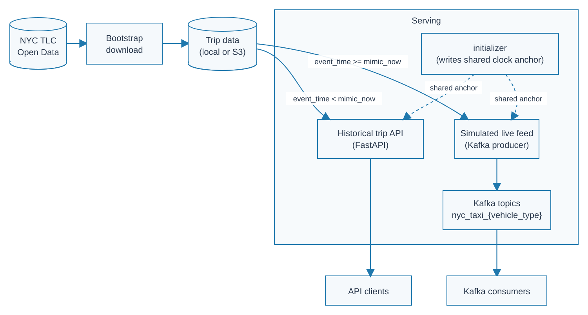

# NYC Taxi Data Service

## Overview
Simulated NYC Taxi data service exposing historical data through a REST API and replaying trip events through Kafka, acting as an upstream data source for data engineering pipelines.


## Architecture



The service runs in two phases:

1. **Bootstrap** (one-time, offline): downloads raw NYC TLC trip data (parquet files) from the public TLC website and writes it to local disk or S3, based on `config/runtime.yaml`. This serves as the data lake for the service.
2. **Serving** (long-running): exposes the downloaded data as if it were a live production system, via three components:
   - **`initializer`** — runs once at startup, creates a "session clock anchor" (see [Mimic Clock](#how-the-mimic-clock--replay-works) section below), and writes it to `service_startup_context.json`.
   - **`api`** — a FastAPI service that answers historical trip queries.
   - **`streaming`** — replays trip events into Kafka topics as if they're arriving in real time.

When `SERVICE_STARTUP_CONTEXT_PATH` is configured, the `api` and `streaming` services both load the same `service_startup_context.json` and reconstruct their `ServiceClock` from the shared anchor. This keeps their mimic clocks synchronized when they run together (e.g. via `docker-compose.serving.yaml`).

When either service is run standalone without a startup context, it creates its own clock anchor using the current wall-clock time.

## How the Mimic Clock / Replay Works

TLC trip data is historical — it was recorded in the past. This service treats this historical data as if it were happening *now*, allowing downstream consumers to build and test against a live-feeling data feed.

- **`mimic_current_date`** (config): the date the service should treat as "today."
- On startup, the service captures two anchor timestamps:
  - `real_service_start_time` — the actual wall-clock time (UTC) at which the service session started.
  - `mimic_service_start_time` — `mimic_current_date` combined with that same wall-clock time, in `America/New_York`.
- From then on, the **mimic clock** advances at the same rate as real time
  ```text
  mimic_now = mimic_service_start_time + (real_now - real_service_start_time)
  ```

For any trip record, its event time is compared against the current mimic time to define the historic vs. streaming data service cutover:
- `event_time < mimic_now`: already "happened" and is queryable through the **API**.
- `event_time >= mimic_now`: hasn't "happened" yet and is held back until the mimic clock reaches its event time, at which point it is replayed through **Kafka**.

As real time passes, the mimic clock advances, so more of the dataset moves from the streaming timeline into the historical range available through the API. Streaming stops when the mimic clock reaches the end of the configured data range (`time_frame.end_year_month`)


## Project Structure

```text
nyc-taxi-data-service/
├── src/
│   └── nyc_taxi_data_service/
│       ├── bootstrap/
│       ├── config/
│       ├── serving/
│       │   ├── api/
│       │   ├── common/
│       │   └── streaming/
│       └── utils/
├── infra/
│   ├── compose/
│   ├── docker/
│   ├── env/
│   └── localstack/
├── tests/
├── data/
├── pyproject.toml
└── README.md
```


## Quickstart: Local
1. Set up and activate the project's Python virtual environment
    ```bash
    uv sync                   # set up project Python environment
    source .venv/bin/activate # activate Python environment
    uv pip install -e .       # install project package
    ```
2. Modify relevant runtime config (`config/runtime.yaml`) as needed, especially:
    - `storage`: storage type and destination; use `local` when serving locally
    - `time_frame`: month range time frame of trip data to download
    - `vehicle_types`: vehicle types of taxi trips (yellow, green, fhv, fhvhv)
    - `serving.mimic_current_date`: date from which the service's mimic clock starts when a session begins
3. Download trip data
    ```bash
    python -m nyc_taxi_data_service.bootstrap.pipeline
    ```
4. Serve the data
    - **Option 1 (Recommended)**: Run the complete serving stack with Docker Compose
        ```bash
        docker compose \
            -f infra/compose/docker-compose.serving.yaml \
            --env-file infra/env/.env.local \
            up
        ```
        This starts Kafka, initializes the shared service clock, and starts both the API and streaming services.
    - **Option 2**: Run the API and streaming services separately
        - *(Recommended)* Set up shared anchor clock time
            - Initialize the service to create a shared anchor clock time
                ```bash
                python -m nyc_taxi_data_service.serving.initializer
                ```
            - Point each service at that generated startup context (run this in each terminal before starting its service)
                ```bash
                export SERVICE_STARTUP_CONTEXT_PATH=$(pwd)/data/manifests/service_startup_context.json
                ```
        - Serve API data: `fastapi dev`
        - Serve streaming data
            - Start a Kafka broker, if not already running
                ```bash
                docker compose -f infra/compose/docker-compose.kafka.yaml up -d
                ```
            - Start streaming pipeline
                ```bash
                python -m nyc_taxi_data_service.serving.streaming.pipeline
                ```
    - See the [API Reference](#api-reference) and [Consuming Streaming Data](#consuming-streaming-data) sections for usage


## Quickstart: AWS
1. Create `infra/env/.env.aws` from template file (`infra/env/.env.aws.template`) and configure the required AWS credentials and region.
2. As with the local setup, modify relevant runtime config (`config/runtime.yaml`) as needed (see step 2 of [Quickstart: Local](#quickstart-local) above), especially:
    - Set `storage.target_storage_type` to `s3`
    - Confirm `time_frame`, `vehicle_types`, `serving.mimic_current_date` and `storage.s3_settings`
3. Download trip data to S3
    ```bash
    docker compose \
        -f infra/compose/docker-compose.bootstrap.yaml \
        --env-file infra/env/.env.aws \
        up
    ```
4. Deploy serving stack

    > TODO: Add Details


## API Reference

### `GET /api/v1/service/context`

Returns metadata about the current service session, including the configured dataset and the current mimic-clock state. This can be used by downstream clients to calibrate themselves before querying trip data.

Response fields include:
- `time_frame`: configured start/end year-month range of the downloaded trip data (`start_year_month`, `end_year_month`)
- `vehicle_types`: vehicle types available in the current session
- `serving.mimic_current_date`: configured mimic "start date"
- `serving.service_clock_anchor`: shared real and mimic timestamps captured when the service session started (`real_service_start_time_utc`, `mimic_service_start_time`) — used to derive the current mimic time as real time elapses
- `serving.service_event_time_column_by_vehicle_type`: event-time column used for each vehicle type
- `serving.mimic_current_datetime`: current mimic timestamp, calculated from the service clock anchor plus elapsed real time since service start

When the API runs with a shared startup context, `service_clock_anchor` is populated from `service_startup_context.json`. When the API runs standalone without one, it creates its own clock and the response's `service_clock_anchor` field can be `null`.


### `GET /api/v1/trips/{vehicle_type}`

Query historical trip records for a vehicle type.

Parameters:
- `vehicle_type` (required, string): `yellow`, `green`, `fhv`, or `fhvhv`
- `start_time` (required, datetime): inclusive start of the requested event-time range
- `end_time` (required, datetime): exclusive end of the requested event-time range; cannot be later than the service's current mimic time.
- `limit` (optional, integer): maximum number of records to return; defaults to `100` and must not exceed `1000`
- `cursor` (optional, string): pagination cursor returned by a previous request


## Consuming Streaming Data

Trip events are published to one Kafka topic per vehicle type, named `nyc_taxi_{vehicle_type}` (e.g. `nyc_taxi_yellow`, `nyc_taxi_green`, `nyc_taxi_fhv`, `nyc_taxi_fhvhv`).

To list available topics:
```bash
docker exec -it broker /opt/kafka/bin/kafka-topics.sh \
    --bootstrap-server broker:29092 \
    --list
```

To consume replayed yellow-taxi events from the Docker Kafka broker:
```bash
docker exec -it broker /opt/kafka/bin/kafka-console-consumer.sh \
    --bootstrap-server broker:29092 \
    --topic nyc_taxi_yellow \
    --from-beginning
```

- `--from-beginning` replays everything currently retained on the topic (up to 24h, per `kafka.topic.retention_ms`); omit it to only see new messages published from this point on.
